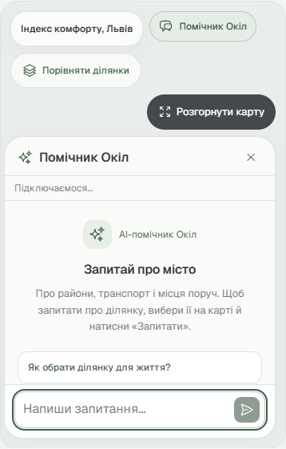
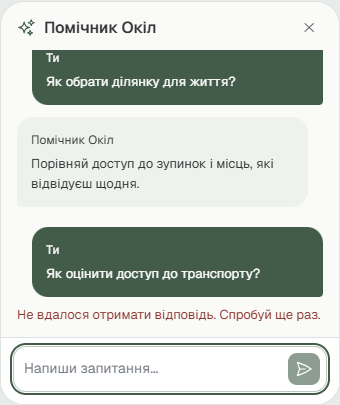

# Перевірка інтерфейсу чату «Помічник Окіл» (#121)

Чат перевірено в Chrome на вбудованій і розгорнутій карті за двох розмірів області перегляду — 1440 × 900 і 390 × 844 CSS-пікселів. Під час перевірки браузер отримував тестові події WebSocket. Це дозволило відтворити затримку підключення, очікування відповіді та помилку для конкретного запитання.

## Сценарії та результати

| Як відтворити | Що відбулося після виправлення |
| --- | --- |
| Відкрити порожній чат і затримати подію `session.ready`. | Панель показує «Підключаємося…». Коли сесія готова, повідомлення зникає. На вітальному екрані можна вибрати приклад запитання. |
| Вибрати приклад і натиснути `Enter`. Після затримки надіслати подію `answer.completed` із підказкою для наступного запитання. | Запитання з’являється в історії один раз. Під час очікування кнопка надсилання неактивна. Відповідь з’являється під запитанням. Натискання на підказку переносить її текст у поле вводу. |
| Надіслати запропоноване запитання й повернути подію `error` з його ідентифікатором `requestId`. | Запитання залишається в історії, а під ним з’являється повідомлення про помилку. Попередня підказка не з’являється повторно. Можна ввести й надіслати інше запитання. |
| Розірвати з’єднання, натиснути «Перепідключити» й набрати чернетку. Закрити чат клавішею `Escape` і відкрити знову. | Після перепідключення відкривається сесія. Клавіша `Escape` повертає фокус на кнопку «Помічник Окіл». Після повторного відкриття чернетка залишається в полі вводу. |
| На вбудованій карті відкрити чат, коли кнопки панелі інструментів займають кілька рядків. | За обох розмірів екрана верхній край чату розташований нижче останнього ряду кнопок карти. |
| На розгорнутій карті залишити поле вводу порожнім, перевести фокус на останній приклад запитання й натиснути `Tab`. | Фокус переходить у поле вводу. Запитання можна набрати з клавіатури. |

Автоматичні тести WebSocket також охоплюють відсутність налаштованої адреси сервісу чату, відновлення історії та надсилання запитання з даними прикріпленої ділянки.

## Скриншоти

**Мобільний екран, 390 × 844.** На знімку робочої області карти видно, що кнопки залишаються над відкритим чатом, а в панелі відображається стан «Підключаємося…».



**Настільний екран, 1440 × 900.** На знімку панелі чату видно відповідь на перше запитання. Друге запитання залишається в історії разом із повідомленням про помилку.



## Окремий збій у тесті HexDebug

Щоб відтворити збій, виконайте команду в корені фронтенду.

```sh
node node_modules/vitest/vitest.mjs run src/HexDebug.test.tsx
```

**Фактичний результат.** Усі перевірки тесту проходять. Після анімації розгортання панелі налагодження її обробник викликає `panel.scrollTo`. У jsdom цей метод відсутній, тож Vitest реєструє необроблену помилку `TypeError: panel.scrollTo is not a function`. Цей самий збій виникає під час запуску всього набору тестів фронтенду.

**Очікуваний результат.** Після перевірки панелі Vitest завершує роботу з кодом 0.
